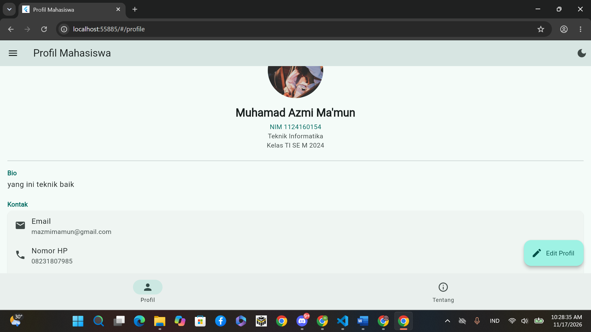
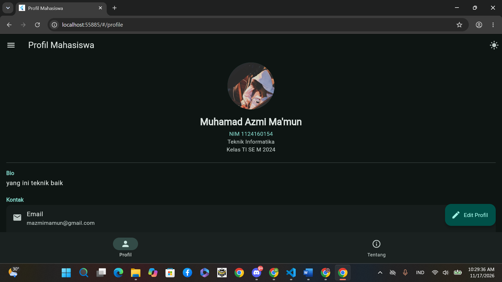

# UTS Pemrograman Mobile Lanjutan (Flutter)

## Identitas

| | |
|---|---|
| **Nama** | Muhamad Azmi Ma'mun |
| **NIM** | 1124160154 |
| **Kelas** | TI SE M 2024 |
| **Program Studi** | Teknik Informatika |
| **Dosen** | I Ketut Gunawan |

## Link

- **Video presentasi YouTube:** 
- **APK (GitHub Releases, tag v1.0.0):** [Unduh di sini](https://github.com/nikolkanaeru/uts-pml-1124160154/releases/tag/v1.0.0)

## Struktur Repository

```
uts-pml-1124160154/
├── soal1-live-coding/    # Soal 1: halaman profil (StatelessWidget)
├── soal2-profil-app/     # Soal 2: aplikasi profil mahasiswa
└── README.md
```

## Soal 1 - Live Coding

Halaman profil mahasiswa yang seluruh widgetnya berupa `StatelessWidget`, mencakup `MaterialApp` (tema terang dan gelap), `Scaffold` dengan `AppBar` dan `FloatingActionButton` yang menampilkan `SnackBar`, serta widget `InfoTile` yang dipakai ulang di dua `Card`.

## Soal 2 - Aplikasi Profil Mahasiswa

### Screenshot

| Profil | Edit Profil | Tentang Saya |
|---|---|---|
|  |  | [Profil2](screenshots/profil2.png) |  |

Tampilan mode gelap:



### Fitur

- **Halaman Profil**: foto dari `assets/images/` dalam `CircleAvatar`, nama, NIM, program studi, kelas, bio, dan kontak (email, nomor HP, GitHub) dalam `Card` + `ListTile`.
- **Halaman Edit Profil**: form dengan nilai awal dari data profil saat ini. Validasi: nama wajib diisi, email harus valid, nomor HP hanya angka 10 sampai 13 digit. Tombol Simpan mengirim data baru ke Halaman Profil lewat `Navigator.pop(context, dataBaru)`, lalu halaman diperbarui dengan `setState()`.
- **Halaman Tentang Saya**: daftar soft skill dan riwayat pendidikan dalam `ListView`.
- **Scaffold lengkap**: `AppBar`, `Drawer`, `NavigationBar` di bagian bawah (Profil dan Tentang), serta `FloatingActionButton` untuk Edit Profil.
- **Tema**: `theme` dan `darkTheme` dengan warna sendiri. Tombol di `AppBar` dan switch di drawer mengubah `themeMode` secara langsung.
- **Nama aplikasi Android**: diatur lewat `android:label` di `AndroidManifest.xml`.

Data disimpan di memori (tanpa server atau database), dan tidak ada paket tambahan selain `flutter` dan `cupertino_icons`.

### Struktur Kode

```
soal2-profil-app/lib/
├── main.dart                     # MaterialApp, tema, routes
├── models/profile.dart           # class Profile
├── screens/
│   ├── profile_page.dart
│   ├── edit_profile_page.dart
│   └── about_page.dart
└── widgets/info_tile.dart        # widget yang dipakai ulang
```

## Cara Menjalankan

Pastikan Flutter sudah terpasang, lalu:

```bash
git clone https://github.com/nikolkanaeru/uts-pml-1124160154.git
cd uts-pml-1124160154/soal2-profil-app
flutter pub get
flutter run
```

Pilih perangkat Android (HP atau emulator) saat diminta.

### Membuat APK

```bash
flutter build apk --release
```

Hasilnya ada di `build/app/outputs/flutter-apk/app-release.apk`.