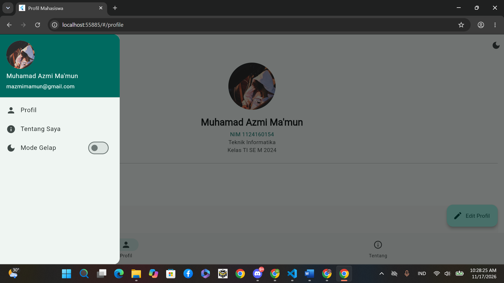
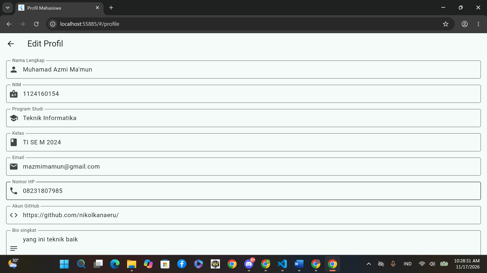
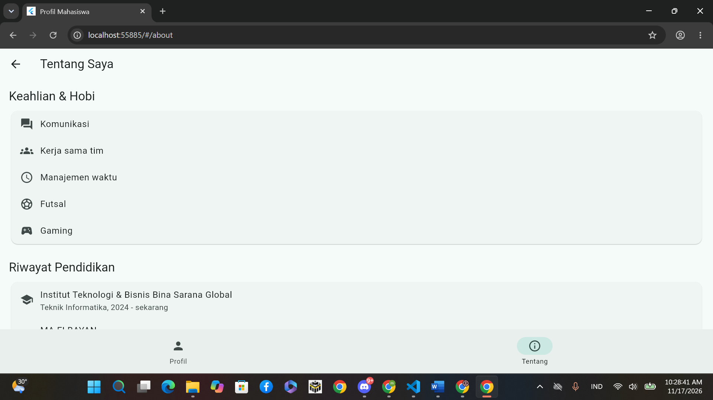

# UTS Pemrograman Mobile Lanjutan (Flutter)

## Identitas

- **Nama Lengkap:** Muhamad Azmi Ma'mun
- **NIM:** 1124160154
- **Program Studi:** Teknik Informatika
- **Kelas:** TI SE M 2024
- **GitHub:** [@nikolkanaeru](https://github.com/nikolkanaeru)
- **Dosen:** I Ketut Gunawan
## Link

- **Video presentasi YouTube:**  https://youtu.be/o_tJ5UYgHVg

## Soal 2 - Aplikasi Profil Mahasiswa

### Screenshot

**Profil**


**Profil (tampilan lain)**



**Edit Profil**



**Tentang Saya**



**Mode Gelap**


### Fitur

- **Halaman Profil**: foto dari `assets/images/` dalam `CircleAvatar`, nama, NIM, program studi, kelas, bio, dan kontak (email, nomor HP, GitHub) dalam `Card` + `ListTile`.
- **Halaman Edit Profil**: form dengan nilai awal dari data profil saat ini. Validasi: nama wajib diisi, email harus valid, nomor HP hanya angka 10 sampai 13 digit. Tombol Simpan mengirim data baru ke Halaman Profil lewat `Navigator.pop(context, dataBaru)`, lalu halaman diperbarui dengan `setState()`.
- **Halaman Tentang Saya**: keahlian,hobi dan riwayat pendidikan dalam `ListView`.
- **Scaffold lengkap**: `AppBar`, `Drawer`, `NavigationBar` di bagian bawah (Profil dan Tentang), serta `FloatingActionButton` untuk Edit Profil.
- **Tema**: `theme` dan `darkTheme` dengan warna sendiri. Tombol di `AppBar` dan switch di drawer mengubah `themeMode` secara langsung.
- **Nama aplikasi Android**: diatur lewat `android:label` di `AndroidManifest.xml`.

Data disimpan di memori (tanpa server atau database), dan tidak ada paket tambahan selain `flutter` dan `cupertino_icons`.


## Cara Menjalankan

Pastikan Flutter sudah terpasang, lalu:

```bash
git clone https://github.com/nikolkanaeru/uts-pml-1124160154.git
cd uts-pml-1124160154/soal2-profil-app
flutter pub get
flutter run
```
### Membuat APK

```bash
flutter build apk --release
```

Hasilnya ada di `build/app/outputs/flutter-apk/app-release.apk`.